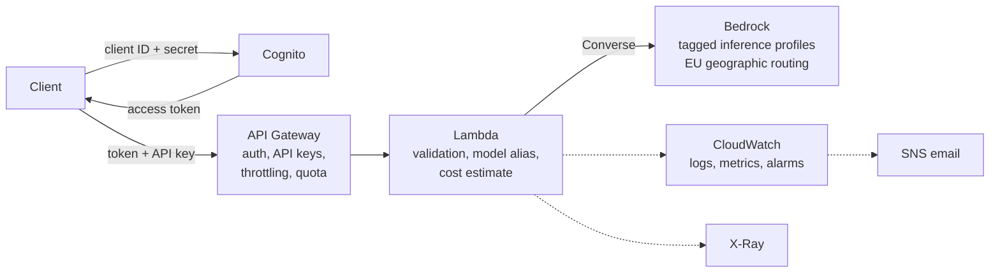

# Serverless GenAI Reference Architecture

A Well-Architected, serverless gateway for using AI models like Claude on AWS, with authenticated access, rate limits, approved models and per-request cost tracking. Built in Terraform, with every design decision mapped to the six AWS Well-Architected pillars.

## Overview

Applications send a chat request to one REST endpoint; the gateway checks who is calling, applies that caller's limits, sends the request to an approved foundation model on Amazon Bedrock, and returns the answer with its token usage and estimated cost. Everything is serverless (API Gateway, Lambda, Bedrock, Cognito, CloudWatch), so there are no servers to manage and almost nothing to pay while it's idle.

It is built to be **learned from**, not just deployed. Every choice is explained and justified against the **AWS Well-Architected Framework** - Operational Excellence, Security, Reliability, Performance Efficiency, Cost Optimization and Sustainability - and the finished stack is reviewed against all six pillars.

## Start Here

| Read | To learn |
|------|----------|
| [docs/WRITEUP.md](docs/WRITEUP.md) | The pattern in brief: the seven ideas behind the design, what the Well-Architected review found, and what's deliberately left out |
| [docs/LEARNING_GUIDE.md](docs/LEARNING_GUIDE.md) | What each AWS service does, how a request flows, why every choice was made and which Well-Architected pillar it serves. Includes self-check questions |
| [docs/ARCHITECTURE.md](docs/ARCHITECTURE.md) | The deployed design: diagram, request walkthrough, security layers, reliability, observability, and known limitations |
| [docs/BUILD_PLAN.md](docs/BUILD_PLAN.md) | The build order and the architecture decisions, each tagged with its Well-Architected pillars and the options considered |
| [bootstrap/iam/README.md](bootstrap/iam/README.md) | Least-privilege IAM set up *before* anything is deployed: temporary credentials, MFA, permissions boundaries - the Security pillar in practice |
| [bootstrap/budget/README.md](bootstrap/budget/README.md) | An AWS Budget with email alerts set up *before* anything is deployed - the Cost Optimization pillar in practice |
| [docs/PREFLIGHT_CHECKS.md](docs/PREFLIGHT_CHECKS.md) | Every setup check with its command, purpose, expected response and common errors - run before the first deploy |
| [docs/DEPLOYMENT.md](docs/DEPLOYMENT.md) | Build, deploy, verify end to end (token, API calls, refusals, metrics, integration tests) and remove the stack |
| [docs/HOW_TO.md](docs/HOW_TO.md) | How to call the model from your own terminal (Python, Node.js, curl, PowerShell) and build it into your own code, including an AWS Lambda function |
| [docs/API_REFERENCE.md](docs/API_REFERENCE.md) | The API contract: authentication, request and response fields, every error, and the limits |
| [docs/COST_ANALYSIS.md](docs/COST_ANALYSIS.md) | Prices, measured per-request costs, scenarios, and the controls that cap spend |
| [docs/WELL_ARCHITECTED_REVIEW.md](docs/WELL_ARCHITECTED_REVIEW.md) | The six-pillar review of the deployed stack: findings, risk ratings and how each was resolved |
| [examples/](examples/README.md) | Python and Node.js clients and curl examples |

## Architecture



[docs/ARCHITECTURE.md](docs/ARCHITECTURE.md) walks through a request step by step.

## Features

| Feature | How | Well-Architected |
|---|---|---|
| **Authenticated access** | OAuth 2.0 client-credentials tokens from Cognito (60 minutes), validated by API Gateway, plus an API key per client | Security |
| **Approved models only** | Clients choose an alias (`fast`, `balanced`, `best`); only configured aliases are accepted, and IAM allows invoking only their models | Security, Cost Optimization |
| **Models change by configuration** | An alias maps to a Bedrock inference profile in `terraform.tfvars`; switching models is a reviewed `terraform apply`, with no client or code change | Operational Excellence |
| **Rate limits and quotas** | Per-client throttle and daily quota (usage plan), whole-API throttle, `max_tokens` cap, request size limit | Reliability, Cost Optimization |
| **Per-request cost** | Every response returns token usage and `cost_estimate_usd`; model spend is also attributed to the stack through tagged application inference profiles | Cost Optimization |
| **Observability** | One metadata-only JSON log line per request with embedded metrics (tokens, cost, latency per alias), X-Ray traces, four alarms to email | Operational Excellence, Reliability |
| **Privacy by default** | Prompts and answers are never logged; errors never expose internal details | Security |
| **EU data residency** | Geographic (`eu.`) cross-region inference profiles keep model inference in EU regions | Security |
| **Least privilege throughout** | The function's role is capped by a permissions boundary; deploy and review roles need MFA and can't change their own guardrails | Security |
| **Efficient by default** | Arm64 (Graviton) Lambda, no idle compute, short log retention | Cost Optimization, Sustainability |
| **Tested** | Unit tests for the function's logic; integration tests against the deployed API, including every refusal | Operational Excellence |

Not yet included: streaming responses (planned), and the controls left to later builds (WAF, customer managed KMS keys, VPC endpoints, Bedrock Guardrails). See [Known limitations](docs/ARCHITECTURE.md#known-limitations-and-trade-offs).

## What's Included

```
serverless_genai_reference_architecture/
├── bootstrap/                  # One-time account setup (administrator runs once)
│   ├── iam/                    # Operator roles, permissions boundary, Cognito user pool
│   └── budget/                 # AWS Budget with email alerts
├── terraform/                  # Infrastructure as code (one file per concern)
│   ├── bedrock.tf              # Tagged application inference profile per model alias
│   ├── iam.tf                  # Function execution role, with permissions boundary
│   ├── lambda.tf               # Function and its log group
│   ├── api.tf                  # REST API, authorizer, usage plan, API keys, throttling
│   ├── cognito.tf              # Token domain, resource server, app clients
│   ├── monitoring.tf           # Alarms, SNS topic, optional access log and dashboard
│   ├── variables.tf, locals.tf, outputs.tf, providers.tf, versions.tf, backend.tf
│   ├── .terraform.lock.hcl     # Pinned provider versions and checksums
│   └── *.example               # Templates for the gitignored terraform.tfvars and backend.hcl
├── lambda/                     # Function source: Node.js 22, TypeScript
│   └── src/                    # index.ts (handler), chat.ts (validation, cost), http.ts (errors),
│                               # config.ts, metrics.ts (EMF), chat.test.ts (unit tests)
├── examples/                   # Python client and curl examples
├── tests/                      # Integration tests against the deployed API
├── docs/                       # Write-up, guides, architecture, API reference, costs, review
├── CHANGELOG.md                # Release notes
└── LICENSE                     # MIT
```

## Quick Start

### Prerequisites

- An AWS account with access to Anthropic models on Amazon Bedrock
- AWS CLI v2, a recent release (2025 or later): older versions lack commands used here, such as `aws bedrock list-inference-profiles`
- Terraform 1.10 or later
- Node.js 22 or later (to build the function)
- Python 3.10 or later (examples and integration tests)

### Deploy

| Step | Guide |
|------|-------|
| 1. One-time account setup (administrator) | [bootstrap/](bootstrap/README.md): least-privilege IAM, Cognito user pool, AWS Budget |
| 2. Verify the account | [docs/PREFLIGHT_CHECKS.md](docs/PREFLIGHT_CHECKS.md) |
| 3. Deploy, verify, remove | [docs/DEPLOYMENT.md](docs/DEPLOYMENT.md) |

In short, once the account is set up and the deploy credentials are loaded:

```bash
npm --prefix lambda ci && npm --prefix lambda test && npm --prefix lambda run build
terraform -chdir=terraform init "-backend-config=backend.hcl"
terraform -chdir=terraform plan -out=tfplan
terraform -chdir=terraform apply tfplan
python tests/test_integration.py
python examples/genai_client.py --from-terraform "Explain AWS Lambda in two sentences."
```

`terraform -chdir=terraform destroy` removes everything the stack created.

## Cost

About **$0.60 per month** fixed while deployed (CloudWatch alarms); everything else is pay-per-request and dominated by model tokens - a short answer from the `fast` alias costs a few thousandths of a cent. Throttles, quotas, a `max_tokens` cap, a daily cost alarm and an account budget limit spend. Details in [docs/COST_ANALYSIS.md](docs/COST_ANALYSIS.md).

## Well-Architected Review

The deployed stack is reviewed against all six pillars of the AWS Well-Architected Framework, using a read-only identity so the review can't change what it examines. Findings, risk levels and remediation status are in [docs/WELL_ARCHITECTED_REVIEW.md](docs/WELL_ARCHITECTED_REVIEW.md).

## What's Next

This is the foundation for a series of builds that extend it into a complete GenAI platform on AWS:

- **RAG** - Bedrock Knowledge Bases, embeddings, managed vector store
- **Security and guardrails** - Bedrock Guardrails, VPC endpoints, KMS, invocation logging
- **Agents** - Bedrock Agents with Lambda action groups
- **Evaluation, monitoring and cost routing** - model evaluation, prompt caching, model routing

## Contributing

This is a reference architecture: fork it, adapt it, and share improvements.

## License

[MIT](LICENSE).
