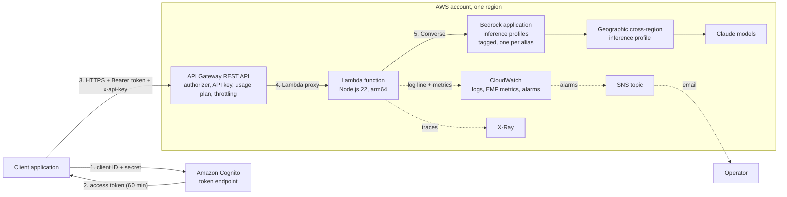

# Architecture

What is deployed, how a request moves through it, and how each part serves the **AWS Well-Architected Framework**. The decisions behind the design are recorded in [BUILD_PLAN.md](BUILD_PLAN.md#architecture-decisions) (D1-D13); this page describes the result.

## Overview

| Component | Role | Defined in |
|---|---|---|
| **Amazon Cognito** | Issues short-lived OAuth 2.0 access tokens to client applications (client-credentials flow). The user pool is created once in `bootstrap/`; this stack adds a domain, a resource server with one scope, and one app client per API client | `terraform/cognito.tf` |
| **API Gateway (REST API)** | The only public entry point. Validates the token and its scope, checks the API key, applies the stage and per-client throttles and the daily quota, and returns errors in one JSON shape. All of this happens before any function or model cost is incurred | `terraform/api.tf` |
| **AWS Lambda** | Validates the request body, resolves the model alias, calls the Bedrock Converse API, computes the cost estimate, and writes one metadata-only log line with embedded metrics | `lambda/src/`, `terraform/lambda.tf` |
| **Bedrock application inference profiles** | One per alias (`fast`, `balanced`, `best`), tagged `Project=powerlab`. The function invokes these, so model spend can be attributed to this stack | `terraform/bedrock.tf` |
| **Geographic cross-region inference profiles** | System-defined (`eu.` prefix). Route each request to one of the regions in the geography for capacity, without leaving it | Selected in `terraform.tfvars` |
| **CloudWatch** | Function log (14 days), model metrics from Embedded Metric Format, four alarms | `terraform/monitoring.tf` |
| **X-Ray** | A trace per invocation of the function | `terraform/lambda.tf` |
| **SNS** | Delivers alarm state changes, optionally by email | `terraform/monitoring.tf` |
| **IAM** | Execution role for the function, capped by the permissions boundary from `bootstrap/iam` | `terraform/iam.tf` |

## A request, step by step

| # | Where | What happens | If it fails |
|---|---|---|---|
| 1-2 | Cognito | The client exchanges its client ID and secret for an access token, then reuses it for 60 minutes | `invalid_client` from Cognito |
| 3 | API Gateway | Token signature, expiry and scope checked by the Cognito authorizer | `401 UNAUTHORIZED` |
| 3 | API Gateway | API key looked up; its usage plan's throttle (2 req/s, burst 5) and daily quota (500) applied, then the stage throttle (5 req/s, burst 10) | `403 INVALID_API_KEY`, `429 THROTTLED`, `429 QUOTA_EXCEEDED` |
| 4 | Lambda | Body size, JSON, fields, alias, message order, `max_tokens` (capped at 1024) and `temperature` validated | `400 invalid_request`, `413 request_too_large` |
| 5 | Lambda -> Bedrock | `Converse` on the alias's application inference profile, with a 25-second timeout and one retry | `429 rate_limited`, `502 upstream_error`, `503 model_unavailable`, `504 timeout` |
| 6 | Lambda | Reply text, token usage and `cost_estimate_usd` returned; one JSON log line written with the model metrics embedded | - |

Every response carries an `x-request-id` header that matches the `request_id` in the function's log, so a client's error report leads straight to the log line. The full contract is in [API_REFERENCE.md](API_REFERENCE.md).

## Security: layers of defence

No single control is relied on; each layer limits the damage if another fails (**Security**: *apply security at all layers*).

| Layer | Control | Protects against |
|---|---|---|
| Identity of callers | Cognito access tokens, 60-minute lifetime, one app client per API client | Anonymous use; a leaked token stays useful for at most an hour |
| Identity of clients for metering | API key per client | One client's traffic being billed to, or throttling, another |
| Request admission | Throttles and quota at API Gateway; strict body validation in the function | Abuse and runaway cost; malformed input reaching the model |
| Model allowlist | Clients send an alias; only configured aliases are accepted, and the function's IAM policy allows invoking only those profiles and the models behind them | Calls to unapproved or more expensive models, even if the function code were changed |
| Workload permissions | Function role limited to its own logs, traces and the allowlisted models, and capped by the permissions boundary | Privilege escalation through the function |
| Operator permissions | Deploy and review roles assumed with MFA, scoped to `powerlab-*` resources, unable to edit their own guardrails (`bootstrap/iam`) | Mistakes or leaked keys affecting other workloads in the account |
| Data handling | Prompts and replies are never logged, only metadata; error messages never include raw service errors | Sensitive content in logs; information leaks through errors |
| Data residency | `eu.` geographic inference profiles keep model inference inside EU regions | Requests processed outside the chosen geography |

## Reliability

| Concern | Design |
|---|---|
| Capacity | Serverless throughout: API Gateway, Lambda and Bedrock scale without servers to manage. Geographic inference profiles spread model requests across several regions |
| Overload | Throttling at two levels (per client, whole API) rejects excess load early with `429`, before it reaches the function or the model |
| Model throttling and errors | The function retries once within its time budget; remaining throttling is returned as `429 rate_limited` so clients back off. `examples/genai_client.py` shows exponential backoff with jitter |
| Timeouts | Bedrock call capped at 25 seconds, inside API Gateway's 29-second limit, so clients get a clean `504` rather than a gateway timeout |
| Shared limits | The account's Lambda concurrency is shared with other workloads; the throttles alarm reports when the function is refused a slot |
| Change | Infrastructure as code, saved plans, and model changes as configuration: switching a model is a reviewed `terraform apply`, not a code change |

## Observability

| Signal | Source | Use |
|---|---|---|
| Function log | One JSON line per request: `request_id`, `route`, `client_id`, `model`, tokens, `cost_estimate_usd`, `model_latency_ms`, `status`, `latency_ms`, error type | Troubleshooting a request; CloudWatch Logs Insights queries |
| Model metrics | Namespace `PowerLab/GenAIApi`, dimension `Model`: `InputTokens`, `OutputTokens`, `CostUSD`, `ModelLatency` | Spend and token trends per alias; latency attribution |
| Service metrics | `AWS/ApiGateway` (requests, 4xx, 5xx, latency) and `AWS/Lambda` (duration, errors, throttles) | Health of the API and function |
| Traces | X-Ray, per function invocation | Where the time goes inside a request |
| Alarms | 5xx, p95 latency, Lambda throttles, daily estimated cost, to SNS | Being told when action is needed |

## Cost

Fixed cost is about $0.60 per month (the alarms); everything else is pay-per-request, dominated by model tokens. [COST_ANALYSIS.md](COST_ANALYSIS.md) has the prices, per-request costs and scenarios.

## Known limitations and trade-offs

Recorded so the [Well-Architected review](WELL_ARCHITECTED_REVIEW.md) can assess them, and so later builds can address them.

| Limitation | Why | Mitigation or plan |
|---|---|---|
| No streaming responses | Phase 3 (optional for this build) | Non-streaming responses are capped by `max_tokens` (1024) to stay within the 29-second limit |
| No API Gateway access log | Needs an account-wide API Gateway CloudWatch role, set by an administrator ([preflight 5.1](PREFLIGHT_CHECKS.md#51-account-level-cloudwatch-role)) | `enable_access_logs`; the function log covers every request that passes authentication |
| No X-Ray on the API stage | Enabling it needs permission to create API Gateway's service-linked role ([preflight 5.2](PREFLIGHT_CHECKS.md#52-x-ray-tracing-on-the-api-stage-optional)) | `enable_api_tracing`; API Gateway latency metrics cover the gateway's share |
| No Lambda reserved concurrency | The account's concurrency limit leaves nothing to reserve | API Gateway throttles cap the load; throttles alarm |
| No AWS WAF | Cost and scope; authentication, throttling and validation cover this build's threat model | Candidate for the security build |
| AWS-managed encryption keys only | Customer managed KMS keys cost $1/month each and add key policy management | Candidate for the security build |
| Public regional endpoint, no VPC | No private resources need protecting; Bedrock and the function use AWS-managed networking | VPC endpoints are in the security build's scope |
| Newest models unavailable to the account | An account-level restriction by AWS ([preflight 6.3](PREFLIGHT_CHECKS.md#63-enable-model-access)) | Aliases mapped to the newest models that work; switching back is a configuration change |
| AWS SDK version chosen by the Lambda runtime | The SDK is not bundled, which keeps the package small and readable | The version used in tests is pinned; bundle it if an exact version is ever required |
| Single region | Sufficient for a reference build; geographic profiles already spread model capacity | Multi-region is out of scope |
