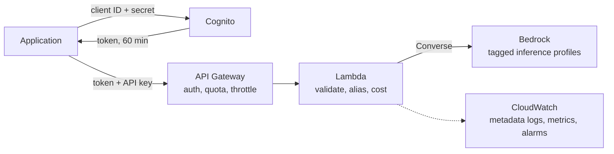

# The Minimal Secure Pattern for a GenAI Endpoint on AWS

Most generative AI prototypes start the same way: an application calls a model API directly, with a key in an environment variable. That works for a demo. It stops working the moment a second application, a second team or a budget owner appears. Who is calling? Which models are they allowed to use? What did it cost, and who pays? What happens when someone loops a request ten thousand times?

This reference architecture is the smallest design that answers those questions on AWS, built entirely from serverless, pay-per-request services and reviewed against the six pillars of the **AWS Well-Architected Framework**. This page explains the pattern and why each part is there. The other docs cover the detail: [ARCHITECTURE.md](ARCHITECTURE.md) (the design), [BUILD_PLAN.md](BUILD_PLAN.md) (the decisions), [WELL_ARCHITECTED_REVIEW.md](WELL_ARCHITECTED_REVIEW.md) (the audit).

## The pattern in one paragraph

Put a **gateway** between applications and the model. Applications authenticate with short-lived OAuth tokens from **Amazon Cognito** and a per-application API key. **API Gateway** checks both, applies per-application throttles and a daily quota, and rejects anything else before it costs money. A small **Lambda** function validates the request, maps a stable **model alias** (`fast`, `balanced`, `best`) to an approved model, calls **Amazon Bedrock**, and returns the answer with its token usage and estimated cost. It logs metadata only, never prompts or answers, and emits per-model metrics that drive four **CloudWatch alarms**. All of it is Terraform, and the function's permissions are capped by a **permissions boundary**.

## Seven ideas that make it work

### 1. Reject early, where it's cheap

Authentication, the API key check, throttling and the daily quota all happen in API Gateway, before the function runs or a model is called. An unauthenticated flood costs nothing beyond API Gateway's own request price, and an authenticated client that loops is stopped by its quota. 🏛️ *Security* (protect at every layer) and *Cost Optimization* (control demand before it reaches compute).

### 2. Aliases, not model IDs

Clients ask for `fast`, `balanced` or `best`, never a model ID. Each alias maps to a model in configuration, so moving to a newer model is a reviewed `terraform apply`, with no client change and no code change. This was tested for real during the build: the newest models turned out to be restricted for the account, so the aliases were mapped to the previous generation in one apply, and clients never noticed. The IAM policy is generated from the same map, so a model that isn't an alias can't be invoked even by a bug. 🏛️ *Operational Excellence* (make changes through configuration) and *Security* (least privilege).

### 3. Every response says what it cost

The function multiplies token usage by the configured prices and returns `cost_estimate_usd` with every answer. It also publishes the cost as a metric per alias, which feeds a daily cost alarm. Model calls go through **application inference profiles** tagged with the project, so the real charges can be traced back to the stack in Cost Explorer as well. The estimate gives a fast signal and the bill gives the true figure. 🏛️ *Cost Optimization* (expenditure awareness).

### 4. Log the shape, not the content

One JSON line per request: who called, which alias, tokens, cost, latency, status, request ID. Never the prompt or the answer. That's enough to debug, alarm and attribute cost without creating a store of sensitive text that would need its own protection. The API Gateway access log does the same for requests refused before the function. 🏛️ *Security* (data classification, minimise sensitive data) and *Operational Excellence* (observability).

### 5. Bound everything

Requests per second per client, requests per day per client, requests per second for the whole API, request body size, answer length (`max_tokens`), model call timeout. Each limit is small and documented, and a daily cost alarm and an account budget sit behind them. No single misconfiguration can produce a runaway bill. 🏛️ *Reliability* (manage service quotas and constraints) and *Cost Optimization*.

### 6. Guardrails on the deployer, too

The identity that runs Terraform needs MFA, can only create roles that carry the permissions boundary, and can't remove the boundary or change its own policies. A separate read-only identity performs the reviews. The function's role can invoke only the configured models and write only its own logs. 🏛️ *Security* (strong identity foundation, least privilege).

### 7. Pay only when used

API Gateway, Lambda (arm64), Bedrock, Cognito and CloudWatch are all billed per request or per use. Idle, the stack costs about $0.60 a month, almost all of it for the alarms. A typical short answer costs a fraction of a cent. `terraform destroy` removes everything, and the stack rebuilds in minutes. 🏛️ *Cost Optimization* (consumption model) and *Sustainability* (no idle resources).

## What the review found

The deployed stack was assessed against all six Well-Architected pillars with a read-only role, then fixed, then re-assessed. The first review found no high risks, 3 medium and 3 low. All of them were account-level settings rather than flaws in the design: an inactive cost allocation tag, a missing API Gateway logging role, a low Lambda concurrency quota, missing deletion protection, a missing state lifecycle rule and Compute Optimizer not enrolled. After remediation, one medium item remains, a quota increase waiting on AWS. Practices the review confirmed as met include least-privilege roles, authentication on every method, bounded load and spend, alarms, efficient compute and infrastructure as code. Full results: [WELL_ARCHITECTED_REVIEW.md](WELL_ARCHITECTED_REVIEW.md).

The lesson worth taking away: in a new or shared account, **account settings are part of the architecture**. Concurrency quotas, logging roles and cost tags are invisible in the code but decide whether the design behaves as intended. That is why the repo checks them before deployment ([PREFLIGHT_CHECKS.md](PREFLIGHT_CHECKS.md)) instead of discovering them in production.

## What's deliberately left out

Minimal means some things are left for later builds, each recorded with its reason ([ARCHITECTURE.md](ARCHITECTURE.md#known-limitations-and-trade-offs)):

| Left out | Why it's acceptable here | Where it goes |
|---|---|---|
| Streaming responses | Answers are capped by `max_tokens` to fit API Gateway's limit | A later release |
| AWS WAF | Authentication, throttling, quotas and validation cover this threat model | Security build |
| Customer managed KMS keys, VPC endpoints | No sensitive content is stored; the services are AWS-managed | Security build |
| Bedrock Guardrails, invocation logging | Content controls need their own privacy design | Security build |

## Use it

Fork the repo, run the one-time account setup ([bootstrap/](../bootstrap/README.md)), work through the [preflight checks](PREFLIGHT_CHECKS.md), then [deploy](DEPLOYMENT.md). The [learning guide](LEARNING_GUIDE.md) explains every service and decision from first principles.
